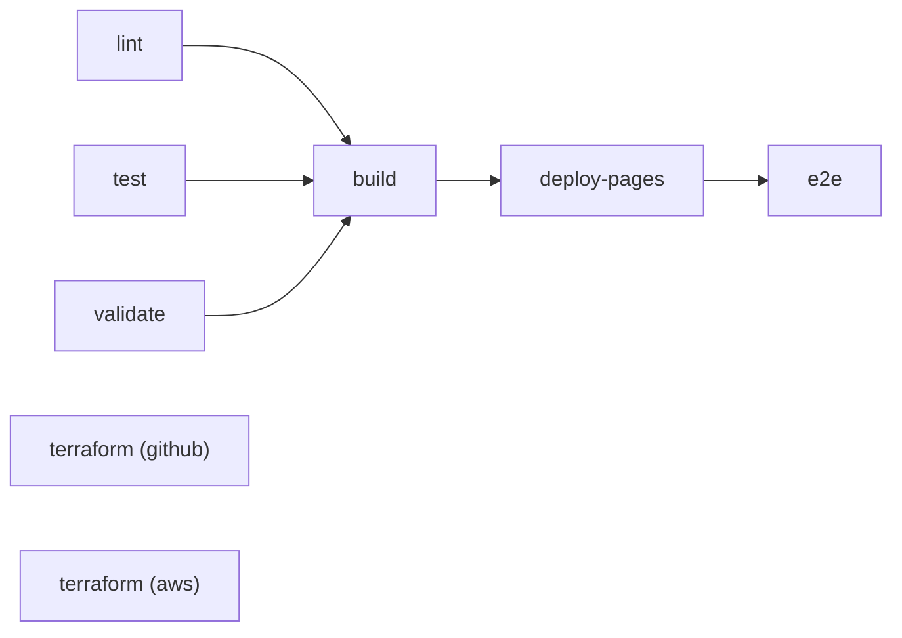

# assistente-qa

[](https://github.com/joaovictorrochaferreira/assistente-qa/actions/workflows/ci.yml)

Projeto da disciplina DevOps na Prática (PUCRS), Fase 1: Configuração e Automação Inicial.

- Repositório: https://github.com/joaovictorrochaferreira/assistente-qa
- Pipeline de CI: https://github.com/joaovictorrochaferreira/assistente-qa/actions/workflows/ci.yml
- Relatório de testes: https://joaovictorrochaferreira.github.io/assistente-qa/

## 1. Descrição do projeto

O repositório guarda a skill de QA `cenarios-de-teste` ([skill/cenarios-de-teste/SKILL.md](skill/cenarios-de-teste/SKILL.md)).
Ela orienta um assistente de IA a escrever cenários de teste em português, no estilo
Gherkin (DADO / QUANDO / ENTÃO), a partir de uma tarefa do ClickUp, de um diff de código
e de regras de negócio. A skill tem um fluxo de 7 etapas e um formato de saída fixo.

A skill é um arquivo de texto, então um erro nela não aparece até alguém usar. Por exemplo,
uma etapa apagada sem querer, um cabeçalho YAML mal formatado ou um exemplo fora do formato.
Para pegar esses erros antes, o projeto tem o qa-toolkit (`src/qa_toolkit/`), um pacote
Python com quatro comandos:

- `qa-toolkit validate-skill <pasta>` confere o cabeçalho do SKILL.md (`name` e
  `description`), se as Etapas 1 a 7 estão lá e em ordem, se as seções obrigatórias
  existem e se os links internos funcionam.
- `qa-toolkit lint-features <arquivos ou pastas>` confere arquivos `.feature` no formato da
  skill: bloco CONTEXTO, IDs `CT001`, `CT002`... sem repetir, DADO / QUANDO / ENTÃO em
  maiúsculas e na ordem, nenhum passo vazio, sem indentação e sem linha em branco entre passos.
- `qa-toolkit package <pasta>` valida a skill e gera `dist/cenarios-de-teste.zip`. O mesmo
  conteúdo sempre gera o mesmo zip.
- `qa-toolkit build-site` monta a página inicial do relatório publicado no GitHub Pages.

O pipeline de CI roda esses comandos a cada push e pull request, junto com lint, testes e
a verificação do Terraform.

## 2. Objetivos

1. Impedir que uma mudança quebre a skill: nada entra na `main` sem passar por lint,
   testes, validação da skill e dos `.feature`.
2. Gerar o pacote da skill automaticamente a cada execução do pipeline.
3. Publicar o resultado dos testes e da cobertura no GitHub Pages, com um teste E2E
   conferindo que a publicação saiu certa.
4. Evitar que tokens ou senhas sejam versionados, com o gitleaks no CI e antes de cada commit.
5. Configurar o repositório com Terraform (proteção da `main`, labels e tópicos) e deixar
   descrito em código um bucket S3 para guardar relatórios.

## 3. Requisitos

### 3.1 Requisitos funcionais

| ID | Requisito |
|---|---|
| RF01 | Validar o cabeçalho do SKILL.md: `name` em minúsculas e hífens, até 64 caracteres e igual ao nome da pasta; `description` com até 1024 caracteres. |
| RF02 | Validar que as Etapas 1 a 7 existem, sem repetição e em ordem, e que existem as seções "Fontes de informação", "Fluxo de trabalho" e "Formato de saída". |
| RF03 | Validar que os links internos do SKILL.md apontam para arquivos e âncoras que existem dentro da pasta da skill. |
| RF04 | Conferir arquivos `.feature` e informar arquivo, linha e motivo de cada problema. |
| RF05 | Gerar o `.zip` da skill só quando ela for válida. |
| RF06 | Publicar no GitHub Pages uma página com total de testes, falhas e cobertura, com links para os relatórios completos. |
| RF07 | Sair com código diferente de zero em qualquer falha, para o pipeline parar. |

### 3.2 Requisitos não funcionais

| ID | Requisito |
|---|---|
| RNF01 | Python 3.12, com uma única dependência de execução (PyYAML). |
| RNF02 | Cobertura de testes de pelo menos 90%. Abaixo disso o pipeline falha. |
| RNF03 | Código sem erros no Ruff (lint e formatação). |
| RNF04 | Nenhum segredo no repositório. Tokens ficam em variáveis de ambiente ou nos segredos do GitHub. |
| RNF05 | Custo zero. A parte aplicada (GitHub) é gratuita e a parte AWS é só validada. |
| RNF06 | Build reproduzível: o mesmo commit gera o mesmo `.zip`. |
| RNF07 | Cada job com tempo limite, e o pipeline inteiro em menos de 10 minutos. |

## 4. Estrutura do repositório

```
.github/workflows/ci.yml        Pipeline de CI (GitHub Actions)
skill/cenarios-de-teste/        A skill de QA (SKILL.md)
src/qa_toolkit/                 Pacote Python: validador, linter, empacotador e relatório
features/                       Arquivos .feature de exemplo, conferidos no CI
tests/unit/                     Testes unitários (pytest)
tests/e2e/                      Teste E2E do relatório publicado (pytest-playwright)
tests/fixtures/                 Skills e .feature válidos e inválidos usados nos testes
infra/terraform/github/         Stack aplicada: configuração do repositório no GitHub
infra/terraform/aws/            Stack só validada: bucket S3 para relatórios
infra/terraform/modules/        Módulos usados pelas duas stacks
.pre-commit-config.yaml         Verificações locais antes de cada commit
.gitleaks.toml                  Configuração da varredura de segredos
pyproject.toml                  Pacote, dependências e configuração do pytest, cobertura e Ruff
```

## 5. Plano de integração contínua

### 5.1 Ferramentas

O código fica no GitHub e o pipeline roda no GitHub Actions, definido em
`.github/workflows/ci.yml`. O lint e a formatação usam o Ruff. Os testes usam pytest, com
pytest-cov para a cobertura e pytest-html para o relatório. O teste E2E usa
pytest-playwright com o Chromium. A busca por segredos usa o gitleaks. O build gera o zip
da skill com o qa-toolkit e o pacote Python com `python -m build`. O relatório vai para o
GitHub Pages, e o Terraform é conferido com `fmt`, `validate` e `plan`.

### 5.2 Quando o pipeline roda

Num push na `main`, o pipeline roda completo, com publicação no Pages e teste E2E. Num pull
request, roda lint, testes, validação, build e Terraform, mas não publica, porque o Pages
só publica a partir da `main`. Também dá para rodar manualmente pela aba Actions.

Num pull request, um push novo cancela a execução anterior do mesmo PR. Na `main` nada é
cancelado, para não interromper uma publicação no meio.

### 5.3 Jobs



| Job | O que faz | Falha quando |
|---|---|---|
| `lint` | Ruff (regras e formatação) e gitleaks no histórico completo | Tem erro de lint, código fora do padrão ou segredo no histórico |
| `test` | Testes unitários com cobertura, relatório HTML e JUnit | Algum teste falha ou a cobertura fica abaixo de 90% |
| `validate` | `validate-skill` na skill e `lint-features` na pasta `features/` | A skill ou algum `.feature` quebra uma regra |
| `build` | Gera o `.zip` da skill e o pacote Python e guarda os dois como artefatos | A skill é inválida ou o empacotamento falha |
| `deploy-pages` | Publica o relatório no GitHub Pages (só na `main`) | A publicação falha |
| `e2e` | Abre o relatório publicado com o Playwright e confere status, falhas, cobertura e links | O relatório não mostra a execução atual aprovada |
| `terraform (github)` | `fmt`, `init`, `validate` e `plan` da stack do GitHub | Formatação, sintaxe ou plano inválidos |
| `terraform (aws)` | `fmt`, `init` e `validate` da stack AWS | Formatação ou sintaxe inválidas |

`lint`, `test`, `validate` e os dois `terraform` rodam em paralelo. O `build` só começa se
os três primeiros passarem. O E2E espera o Pages mostrar o ID da execução atual antes de
conferir, porque logo depois do deploy o Pages ainda pode estar servindo a versão anterior.

### 5.4 Artefatos

Cada execução guarda o `cenarios-de-teste.zip` (artefato `cenarios-de-teste-skill`) e o
wheel e o sdist do qa-toolkit (`qa-toolkit-python`), pelo prazo padrão de 90 dias do GitHub.
Os relatórios HTML e XML de testes e cobertura (`relatorio-testes`) ficam 14 dias. Quando o
E2E falha, os traces do Playwright (`playwright-traces`) ficam 7 dias para investigação.

### 5.5 Proteção da `main`

O Terraform (seção 6.2) configura a `main` para só aceitar merge com `lint`, `test`,
`validate`, `build`, `terraform (github)` e `terraform (aws)` aprovados e com a branch
atualizada. Force push e exclusão da `main` ficam bloqueados.

### 5.6 Verificações antes do commit (pre-commit)

```powershell
pip install -e ".[dev]"
pre-commit install
```

Depois disso, cada commit roda Ruff, gitleaks, `terraform fmt`, a validação da skill e o
lint dos `.feature` alterados, antes de o código ir para o GitHub.

## 6. Especificação da infraestrutura

### 6.1 Visão geral

Tudo o que está em uso é gratuito. O repositório é público no GitHub, o CI roda nos runners
`ubuntu-latest` do GitHub Actions e o relatório fica no GitHub Pages. A configuração do
repositório (proteção da `main`, labels e tópicos) é feita pela stack `github` do
Terraform, que foi aplicada. O bucket S3 está descrito na stack `aws`, que é só validada e
nunca foi aplicada.

Versões: Terraform 1.17, provider `integrations/github` 6.x e provider `hashicorp/aws` 6.x,
travadas nos arquivos `.terraform.lock.hcl`.

### 6.2 Stack `github` (aplicada)

Fica em `infra/terraform/github/` e usa o módulo `modules/github-repo-governance/`.

| Recurso | Configuração |
|---|---|
| `github_branch_protection` | Branch `main`; checks obrigatórios do CI; branch atualizada antes do merge (`strict`); histórico linear; conversas resolvidas antes do merge; sem force push; sem exclusão. `enforce_admins = false`, para o dono do repositório poder corrigir a `main` numa emergência. |
| `github_issue_label` (7) | `tipo: bug`, `tipo: melhoria`, `area: skill`, `area: ci`, `area: infra`, `area: testes`, `area: documentacao` |
| `github_repository_topics` | `devops`, `github-actions`, `terraform`, `qa`, `gherkin`, `test-automation`, `python`, `claude-skill` |

Variáveis: `github_owner` (obrigatória), `repository_name` (padrão `assistente-qa`) e
`required_status_checks` (padrão: os seis jobs obrigatórios do CI).

Para aplicar (PowerShell):

```powershell
# O token fica só na sessão do terminal, nunca em arquivo.
# Permissão necessária: Administration (leitura e escrita) no repositório.
$env:GITHUB_TOKEN = "<seu token>"

cd infra\terraform\github
terraform init
terraform plan  -var="github_owner=joaovictorrochaferreira"
terraform apply -var="github_owner=joaovictorrochaferreira"
```

A ordem importa: o apply só deve rodar depois que o CI passou pelo menos uma vez. Antes
disso o GitHub não conhece os nomes dos checks, e a proteção bloquearia os merges
esperando checks que nunca rodaram.

O estado (`terraform.tfstate`) fica na máquina de quem aplica e está no `.gitignore`. Por
isso o `plan` do CI não enxerga o estado e sempre mostra a configuração completa, como se
fosse criar tudo. O resultado aparece no resumo da execução, na aba Actions.

### 6.3 Stack `aws` (só validada)

Fica em `infra/terraform/aws/` e usa o módulo `modules/s3-reports-bucket/`. Descreve um
bucket para guardar os relatórios por mais tempo do que os artefatos do Actions.

| Recurso | Configuração |
|---|---|
| `aws_s3_bucket` | Nome `assistente-qa-relatorios-<ambiente>-<id da conta>`, ou outro informado, com as tags `Projeto`, `Ambiente` e `Gerenciado` |
| `aws_s3_bucket_public_access_block` | Todo acesso público bloqueado |
| `aws_s3_bucket_ownership_controls` | `BucketOwnerEnforced` (ACLs desativadas) |
| `aws_s3_bucket_versioning` | Versionamento ligado |
| `aws_s3_bucket_server_side_encryption_configuration` | Criptografia AES256 com bucket key |
| `aws_s3_bucket_lifecycle_configuration` | Relatórios em `relatorios/` apagados em 90 dias, versões antigas em 30 dias e uploads incompletos em 7 dias |
| `aws_s3_bucket_policy` | Bloqueia qualquer acesso sem TLS (`aws:SecureTransport = false`) |

Variáveis: `aws_region` (padrão `us-east-1`), `environment` (`dev`, `hml` ou `prd`),
`bucket_name` e `report_retention_days`. O CI roda só `fmt` e `validate`, que não precisam
de credenciais. Para aplicar seria preciso uma conta AWS e credenciais no ambiente.

### 6.4 Segredos e permissões

O token do GitHub usado pelo Terraform fica só na variável de ambiente `GITHUB_TOKEN` do
terminal. No CI, o workflow usa o `GITHUB_TOKEN` automático do Actions com permissão
`contents: read`, e só o job `deploy-pages` recebe `pages: write` e `id-token: write`. Os
arquivos `*.tfstate`, `*.tfvars` e `.env` estão no `.gitignore`. O gitleaks confere o
histórico completo no CI e os arquivos alterados em cada commit.

## 7. Como rodar localmente (Windows, PowerShell)

```powershell
py -3.12 -m venv .venv
.\.venv\Scripts\Activate.ps1
pip install -e ".[dev]"

ruff check .
ruff format --check .
pytest --cov
qa-toolkit validate-skill skill\cenarios-de-teste
qa-toolkit lint-features features
qa-toolkit package skill\cenarios-de-teste --output dist

# E2E contra o relatório publicado
python -m playwright install chromium
pytest tests\e2e --base-url https://joaovictorrochaferreira.github.io/assistente-qa/
```
