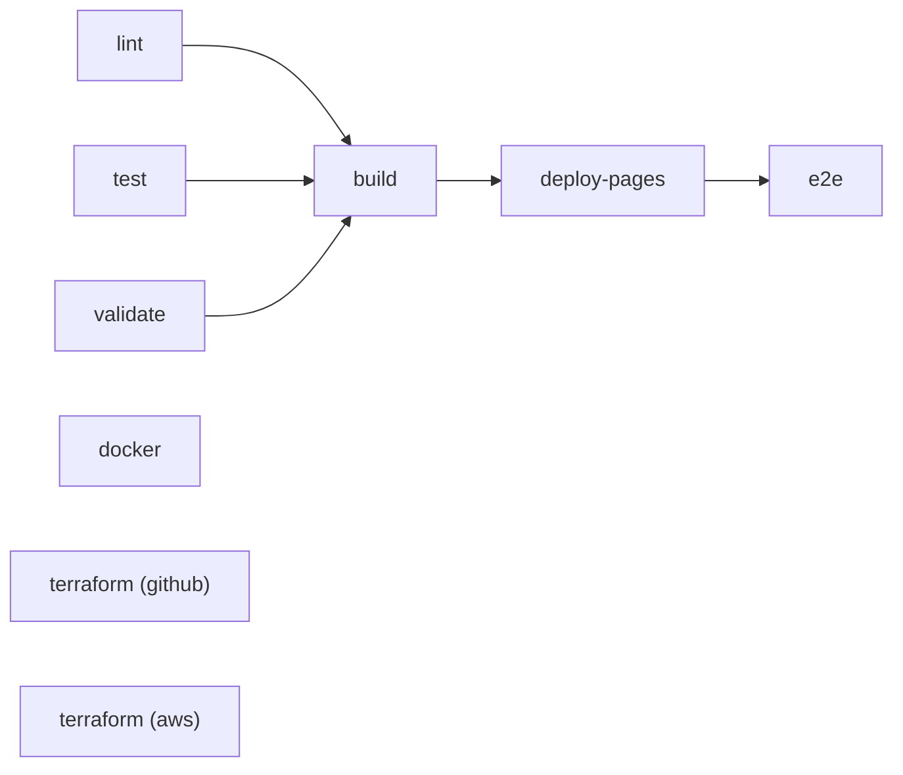
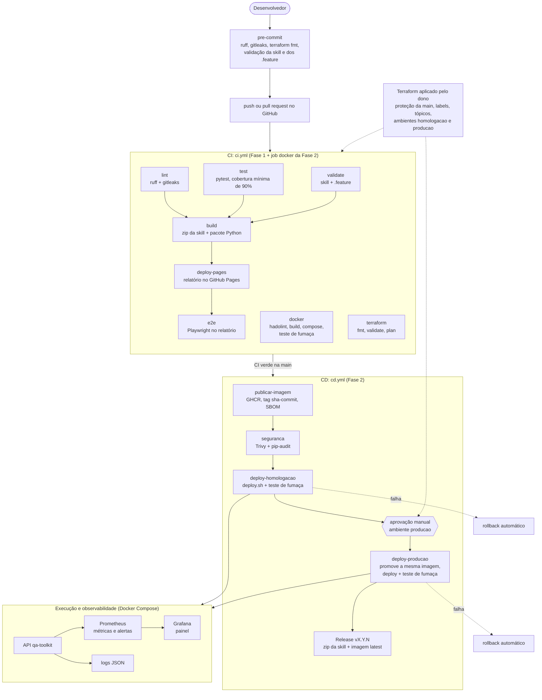

# assistente-qa

[](https://github.com/joaovictorrochaferreira/assistente-qa/actions/workflows/ci.yml)
[](https://github.com/joaovictorrochaferreira/assistente-qa/actions/workflows/cd.yml)

Projeto da disciplina DevOps na Prática (PUCRS).
Fase 1: Configuração e Automação Inicial (seções 1 a 6).
Fase 2: Entrega Contínua, Containers, Monitoramento e Segurança (seções 7 a 10).

- Repositório: https://github.com/joaovictorrochaferreira/assistente-qa
- Pipeline de CI: https://github.com/joaovictorrochaferreira/assistente-qa/actions/workflows/ci.yml
- Pipeline de CD: https://github.com/joaovictorrochaferreira/assistente-qa/actions/workflows/cd.yml
- Relatório de testes: https://joaovictorrochaferreira.github.io/assistente-qa/
- Imagens Docker: https://github.com/joaovictorrochaferreira/assistente-qa/pkgs/container/assistente-qa
- Versões liberadas: https://github.com/joaovictorrochaferreira/assistente-qa/releases

## 1. Descrição do projeto

O repositório guarda a skill de QA `cenarios-de-teste` ([skill/cenarios-de-teste/SKILL.md](skill/cenarios-de-teste/SKILL.md)).
Ela orienta um assistente de IA a escrever cenários de teste em português, no estilo
Gherkin (DADO / QUANDO / ENTÃO), a partir de uma tarefa do ClickUp, de um diff de código
e de regras de negócio. A skill tem um fluxo de 7 etapas e um formato de saída fixo.

A skill é um arquivo de texto, então um erro nela não aparece até alguém usar. Por exemplo,
uma etapa apagada sem querer, um cabeçalho YAML mal formatado ou um exemplo fora do formato.
Para pegar esses erros antes, o projeto tem o qa-toolkit (`src/qa_toolkit/`), um pacote
Python com quatro comandos:

- `qa-toolkit validate-skill <pasta>` confere o cabeçalho do SKILL.md (`name` e
  `description`), se as Etapas 1 a 7 estão lá e em ordem, se as seções obrigatórias
  existem e se os links internos funcionam.
- `qa-toolkit lint-features <arquivos ou pastas>` confere arquivos `.feature` no formato da
  skill: bloco CONTEXTO, IDs `CT001`, `CT002`... sem repetir, DADO / QUANDO / ENTÃO em
  maiúsculas e na ordem, nenhum passo vazio, sem indentação e sem linha em branco entre passos.
- `qa-toolkit package <pasta>` valida a skill e gera `dist/cenarios-de-teste.zip`. O mesmo
  conteúdo sempre gera o mesmo zip.
- `qa-toolkit build-site` monta a página inicial do relatório publicado no GitHub Pages.

O pipeline de CI roda esses comandos a cada push e pull request, junto com lint, testes e
a verificação do Terraform.

Na Fase 2, o qa-toolkit ganhou também uma API HTTP (`qa-toolkit serve`), que roda em
container e é entregue pelo pipeline de CD. Ela está descrita na seção 7.

## 2. Objetivos

1. Impedir que uma mudança quebre a skill: nada entra na `main` sem passar por lint,
   testes, validação da skill e dos `.feature`.
2. Gerar o pacote da skill automaticamente a cada execução do pipeline.
3. Publicar o resultado dos testes e da cobertura no GitHub Pages, com um teste E2E
   conferindo que a publicação saiu certa.
4. Evitar que tokens ou senhas sejam versionados, com o gitleaks no CI e antes de cada commit.
5. Configurar o repositório com Terraform (proteção da `main`, labels e tópicos) e deixar
   descrito em código um bucket S3 para guardar relatórios.

## 3. Requisitos

### 3.1 Requisitos funcionais

| ID | Requisito |
|---|---|
| RF01 | Validar o cabeçalho do SKILL.md: `name` em minúsculas e hífens, até 64 caracteres e igual ao nome da pasta; `description` com até 1024 caracteres. |
| RF02 | Validar que as Etapas 1 a 7 existem, sem repetição e em ordem, e que existem as seções "Fontes de informação", "Fluxo de trabalho" e "Formato de saída". |
| RF03 | Validar que os links internos do SKILL.md apontam para arquivos e âncoras que existem dentro da pasta da skill. |
| RF04 | Conferir arquivos `.feature` e informar arquivo, linha e motivo de cada problema. |
| RF05 | Gerar o `.zip` da skill só quando ela for válida. |
| RF06 | Publicar no GitHub Pages uma página com total de testes, falhas e cobertura, com links para os relatórios completos. |
| RF07 | Sair com código diferente de zero em qualquer falha, para o pipeline parar. |

### 3.2 Requisitos não funcionais

| ID | Requisito |
|---|---|
| RNF01 | Python 3.12, com uma única dependência de execução (PyYAML). |
| RNF02 | Cobertura de testes de pelo menos 90%. Abaixo disso o pipeline falha. |
| RNF03 | Código sem erros no Ruff (lint e formatação). |
| RNF04 | Nenhum segredo no repositório. Tokens ficam em variáveis de ambiente ou nos segredos do GitHub. |
| RNF05 | Custo zero. A parte aplicada (GitHub) é gratuita e a parte AWS é só validada. |
| RNF06 | Build reproduzível: o mesmo commit gera o mesmo `.zip`. |
| RNF07 | Cada job com tempo limite, e o pipeline inteiro em menos de 10 minutos. |

## 4. Estrutura do repositório

```
.github/workflows/ci.yml        Pipeline de CI (GitHub Actions)
.github/workflows/cd.yml        Pipeline de CD: imagem, segurança, homologação e produção
.github/dependabot.yml          Atualização automática de dependências
skill/cenarios-de-teste/        A skill de QA (SKILL.md)
src/qa_toolkit/                 Pacote Python: validador, linter, empacotador, relatório e API
Dockerfile                      Imagem da API (dois estágios, usuário sem privilégios)
docker-compose.yml              Orquestração: API + Prometheus + Grafana
deploy/*.env                    Configuração de cada ambiente (homologação e produção)
deploy/monitoramento/           Prometheus (coleta e alertas) e painel do Grafana
scripts/deploy.sh, deploy.ps1   Scripts de deploy com teste de fumaça e rollback
features/                       Arquivos .feature de exemplo, conferidos no CI
tests/unit/                     Testes unitários (pytest)
tests/e2e/                      Teste E2E do relatório publicado (pytest-playwright)
tests/fixtures/                 Skills e .feature válidos e inválidos usados nos testes
infra/terraform/github/         Stack aplicada: configuração do repositório no GitHub
infra/terraform/aws/            Stack só validada: bucket S3 para relatórios
infra/terraform/modules/        Módulos usados pelas duas stacks
.pre-commit-config.yaml         Verificações locais antes de cada commit
.gitleaks.toml                  Configuração da varredura de segredos
pyproject.toml                  Pacote, dependências e configuração do pytest, cobertura e Ruff
```

## 5. Plano de integração contínua

### 5.1 Ferramentas

O código fica no GitHub e o pipeline roda no GitHub Actions, definido em
`.github/workflows/ci.yml`. O lint e a formatação usam o Ruff. Os testes usam pytest, com
pytest-cov para a cobertura e pytest-html para o relatório. O teste E2E usa
pytest-playwright com o Chromium. A busca por segredos usa o gitleaks. O build gera o zip
da skill com o qa-toolkit e o pacote Python com `python -m build`. O relatório vai para o
GitHub Pages, e o Terraform é conferido com `fmt`, `validate` e `plan`.

### 5.2 Quando o pipeline roda

Num push na `main`, o pipeline roda completo, com publicação no Pages e teste E2E. Num pull
request, roda lint, testes, validação, build e Terraform, mas não publica, porque o Pages
só publica a partir da `main`. Também dá para rodar manualmente pela aba Actions.

Num pull request, um push novo cancela a execução anterior do mesmo PR. Na `main` nada é
cancelado, para não interromper uma publicação no meio.

### 5.3 Jobs



| Job | O que faz | Falha quando |
|---|---|---|
| `lint` | Ruff (regras e formatação) e gitleaks no histórico completo | Tem erro de lint, código fora do padrão ou segredo no histórico |
| `test` | Testes unitários com cobertura, relatório HTML e JUnit | Algum teste falha ou a cobertura fica abaixo de 90% |
| `validate` | `validate-skill` na skill e `lint-features` na pasta `features/` | A skill ou algum `.feature` quebra uma regra |
| `build` | Gera o `.zip` da skill e o pacote Python e guarda os dois como artefatos | A skill é inválida ou o empacotamento falha |
| `deploy-pages` | Publica o relatório no GitHub Pages (só na `main`) | A publicação falha |
| `e2e` | Abre o relatório publicado com o Playwright e confere status, falhas, cobertura e links | O relatório não mostra a execução atual aprovada |
| `docker` | Lint do Dockerfile (hadolint), validação do Compose e deploy local completo com teste de fumaça (Fase 2) | A imagem não constrói, a API não fica saudável ou o teste de fumaça falha |
| `terraform (github)` | `fmt`, `init`, `validate` e `plan` da stack do GitHub | Formatação, sintaxe ou plano inválidos |
| `terraform (aws)` | `fmt`, `init` e `validate` da stack AWS | Formatação ou sintaxe inválidas |

`lint`, `test`, `validate`, `docker` e os dois `terraform` rodam em paralelo. O `build` só começa se
os três primeiros passarem. O E2E espera o Pages mostrar o ID da execução atual antes de
conferir, porque logo depois do deploy o Pages ainda pode estar servindo a versão anterior.

### 5.4 Artefatos

Cada execução guarda o `cenarios-de-teste.zip` (artefato `cenarios-de-teste-skill`) e o
wheel e o sdist do qa-toolkit (`qa-toolkit-python`), pelo prazo padrão de 90 dias do GitHub.
Os relatórios HTML e XML de testes e cobertura (`relatorio-testes`) ficam 14 dias. Quando o
E2E falha, os traces do Playwright (`playwright-traces`) ficam 7 dias para investigação.

### 5.5 Proteção da `main`

O Terraform (seção 6.2) configura a `main` para só aceitar merge com `lint`, `test`,
`validate`, `build`, `docker`, `terraform (github)` e `terraform (aws)` aprovados e com a
branch atualizada. Force push e exclusão da `main` ficam bloqueados.

### 5.6 Verificações antes do commit (pre-commit)

```powershell
pip install -e ".[dev]"
pre-commit install
```

Depois disso, cada commit roda Ruff, gitleaks, `terraform fmt`, a validação da skill e o
lint dos `.feature` alterados, antes de o código ir para o GitHub.

## 6. Especificação da infraestrutura

### 6.1 Visão geral

Tudo o que está em uso é gratuito. O repositório é público no GitHub, o CI roda nos runners
`ubuntu-latest` do GitHub Actions e o relatório fica no GitHub Pages. A configuração do
repositório (proteção da `main`, labels e tópicos) é feita pela stack `github` do
Terraform, que foi aplicada. O bucket S3 está descrito na stack `aws`, que é só validada e
nunca foi aplicada.

Versões: Terraform 1.17, provider `integrations/github` 6.x e provider `hashicorp/aws` 6.x,
travadas nos arquivos `.terraform.lock.hcl`.

### 6.2 Stack `github` (aplicada)

Fica em `infra/terraform/github/` e usa o módulo `modules/github-repo-governance/`.

| Recurso | Configuração |
|---|---|
| `github_branch_protection` | Branch `main`; checks obrigatórios do CI; branch atualizada antes do merge (`strict`); histórico linear; conversas resolvidas antes do merge; sem force push; sem exclusão. `enforce_admins = false`, para o dono do repositório poder corrigir a `main` numa emergência. |
| `github_issue_label` (7) | `tipo: bug`, `tipo: melhoria`, `area: skill`, `area: ci`, `area: infra`, `area: testes`, `area: documentacao` |
| `github_repository_topics` | `devops`, `github-actions`, `terraform`, `qa`, `gherkin`, `test-automation`, `python`, `claude-skill` |
| `github_repository_environment` (2, Fase 2) | `homologacao`, sem aprovação, e `producao`, que exige a aprovação do dono do repositório antes de cada deploy. Nos dois, só a branch protegida (`main`) pode implantar. |

Variáveis: `github_owner` (obrigatória), `repository_name` (padrão `assistente-qa`) e
`required_status_checks` (padrão: os sete jobs obrigatórios do CI).

Para aplicar (PowerShell):

```powershell
# O token fica só na sessão do terminal, nunca em arquivo.
# Permissão necessária: Administration (leitura e escrita) no repositório.
$env:GITHUB_TOKEN = "<seu token>"

cd infra\terraform\github
terraform init
terraform plan  -var="github_owner=joaovictorrochaferreira"
terraform apply -var="github_owner=joaovictorrochaferreira"
```

A ordem importa: o apply só deve rodar depois que o CI passou pelo menos uma vez. Antes
disso o GitHub não conhece os nomes dos checks, e a proteção bloquearia os merges
esperando checks que nunca rodaram.

O estado (`terraform.tfstate`) fica na máquina de quem aplica e está no `.gitignore`. Por
isso o `plan` do CI não enxerga o estado e sempre mostra a configuração completa, como se
fosse criar tudo. O resultado aparece no resumo da execução, na aba Actions.

### 6.3 Stack `aws` (só validada)

Fica em `infra/terraform/aws/` e usa o módulo `modules/s3-reports-bucket/`. Descreve um
bucket para guardar os relatórios por mais tempo do que os artefatos do Actions.

| Recurso | Configuração |
|---|---|
| `aws_s3_bucket` | Nome `assistente-qa-relatorios-<ambiente>-<id da conta>`, ou outro informado, com as tags `Projeto`, `Ambiente` e `Gerenciado` |
| `aws_s3_bucket_public_access_block` | Todo acesso público bloqueado |
| `aws_s3_bucket_ownership_controls` | `BucketOwnerEnforced` (ACLs desativadas) |
| `aws_s3_bucket_versioning` | Versionamento ligado |
| `aws_s3_bucket_server_side_encryption_configuration` | Criptografia AES256 com bucket key |
| `aws_s3_bucket_lifecycle_configuration` | Relatórios em `relatorios/` apagados em 90 dias, versões antigas em 30 dias e uploads incompletos em 7 dias |
| `aws_s3_bucket_policy` | Bloqueia qualquer acesso sem TLS (`aws:SecureTransport = false`) |

Variáveis: `aws_region` (padrão `us-east-1`), `environment` (`dev`, `hml` ou `prd`),
`bucket_name` e `report_retention_days`. O CI roda só `fmt` e `validate`, que não precisam
de credenciais. Para aplicar seria preciso uma conta AWS e credenciais no ambiente.

### 6.4 Segredos e permissões

O token do GitHub usado pelo Terraform fica só na variável de ambiente `GITHUB_TOKEN` do
terminal. No CI, o workflow usa o `GITHUB_TOKEN` automático do Actions com permissão
`contents: read`, e só o job `deploy-pages` recebe `pages: write` e `id-token: write`. Os
arquivos `*.tfstate`, `*.tfvars` e `.env` estão no `.gitignore`. O gitleaks confere o
histórico completo no CI e os arquivos alterados em cada commit.

## 7. Fase 2: API, containers e orquestração

### 7.1 A API

`qa-toolkit serve` sobe uma API HTTP ([src/qa_toolkit/api.py](src/qa_toolkit/api.py)), feita
com FastAPI, que expõe as mesmas validações da linha de comando:

| Rota | O que faz |
|---|---|
| `GET /health` | Diz se o serviço está no ar. Usada pelo Docker, pelo deploy e pelo teste de fumaça. |
| `POST /lint` | Recebe `{"conteudo": "<texto do .feature>"}` e devolve os problemas, com linha e motivo. |
| `POST /validate-skill` | Recebe `{"conteudo": "<texto do SKILL.md>"}` e devolve os problemas. |
| `GET /metrics` | Métricas no formato do Prometheus. |
| `GET /docs` | Documentação interativa gerada pelo FastAPI. |

Exemplo de uso, com a API rodando (PowerShell do Windows):

```powershell
$texto = [IO.File]::ReadAllText((Resolve-Path features\login.feature))   # lê em UTF-8
$corpo = [Text.Encoding]::UTF8.GetBytes((@{ conteudo = $texto } | ConvertTo-Json))
Invoke-RestMethod -Method Post -Uri http://localhost:8000/lint -Body $corpo -ContentType "application/json; charset=utf-8"
# {"valido": true, "total_problemas": 0, "problemas": []}
```

No Linux ou no Git Bash:

```bash
curl -X POST http://localhost:8000/lint -H "Content-Type: application/json" \
  -d '{"conteudo": "CT001 - Sem contexto\nDADO algo\nQUANDO\n"}'
# {"valido": false, "total_problemas": 3, "problemas": [...]}
```

A configuração vem de variáveis de ambiente, então a mesma imagem serve todos os ambientes:
`QA_TOOLKIT_AMBIENTE` (nome do ambiente), `QA_TOOLKIT_LOG_LEVEL` (nível de log) e
`QA_TOOLKIT_MAX_BYTES` (tamanho máximo do conteúdo enviado, 256 KB por padrão; acima disso a
API responde 413).

### 7.2 Container (Docker)

O [Dockerfile](Dockerfile) tem dois estágios. O primeiro gera o pacote wheel a partir do
código. O segundo instala só esse pacote numa imagem `python:3.12-slim` limpa, sem
código-fonte nem ferramentas de build. Antes disso, aplica as correções de segurança dos
pacotes do sistema e atualiza o pip e o setuptools da imagem base, que vinham com falhas
conhecidas. A imagem final tem cerca de 240 MB.

Segurança da imagem e do container:
- roda com o usuário `app` (uid 10001), nunca como root;
- no Compose, o sistema de arquivos do container é somente leitura, todas as *capabilities*
  do Linux são removidas e `no-new-privileges` impede a escalada de privilégio;
- limites de CPU (0,5) e memória (256 MB);
- `HEALTHCHECK` chama `/health` a cada 10 segundos.

### 7.3 Orquestração (Docker Compose)

O [docker-compose.yml](docker-compose.yml) sobe três serviços que trabalham juntos:

| Serviço | Papel | Endereço local |
|---|---|---|
| `api` | A API do qa-toolkit | http://localhost:8000 |
| `prometheus` | Coleta as métricas da API a cada 5 segundos e avalia as regras de alerta | http://localhost:9090 |
| `grafana` | Painel com requisições, latência, validações e problemas encontrados | http://localhost:3000 |

O Prometheus só sobe depois que a API fica saudável (`depends_on` com `service_healthy`), e
cada serviço reinicia sozinho se cair (`restart: unless-stopped`). As portas ficam presas em
`127.0.0.1`, então nada é exposto para a rede.

Cada ambiente tem seu arquivo de configuração em [deploy/](deploy/): `homologacao.env` usa as
portas 8001, 9091 e 3001 e log em nível DEBUG, e `producao.env` usa as portas 8000, 9090 e
3000 e log em nível INFO. Os dois podem rodar ao mesmo tempo na mesma máquina.

### 7.4 Scripts de deploy

[scripts/deploy.sh](scripts/deploy.sh) (usado pelo CI) e [scripts/deploy.ps1](scripts/deploy.ps1)
(para Windows) fazem as mesmas etapas:

1. obtêm a imagem: constroem se for `qa-toolkit:local`, usam a da máquina se já existir, ou
   baixam do registro;
2. sobem os três containers e esperam a API ficar saudável (até 120 segundos);
3. rodam o teste de fumaça de dentro do container da API (`qa-toolkit smoke-test`): conferem
   `/health`, um `/lint` com arquivo válido, um `/lint` com arquivo inválido, `/metrics` e se
   o Prometheus está coletando a API;
4. se tudo passar, gravam a imagem como a última aprovada daquele ambiente;
5. se algo falhar, mostram os logs da API, **voltam para a última imagem aprovada (rollback)**
   e terminam com erro, o que deixa o pipeline vermelho.

```powershell
# Windows: constrói a imagem local e sobe tudo
powershell -ExecutionPolicy Bypass -File scripts\deploy.ps1 -Ambiente local

# Homologação com uma imagem publicada pelo CD
powershell -ExecutionPolicy Bypass -File scripts\deploy.ps1 -Ambiente homologacao -Imagem ghcr.io/joaovictorrochaferreira/assistente-qa:latest

# Derrubar um ambiente
docker compose -p qa-local down -v
```

O rollback foi testado forçando o deploy de uma imagem que não sobe: o script detectou a
falha, mostrou o erro nos logs e voltou sozinho para a versão anterior.

## 8. Fase 2: pipeline de entrega contínua (CD)

### 8.1 Como funciona

O [cd.yml](.github/workflows/cd.yml) começa sozinho quando o CI termina **com sucesso** na
`main`. Ele usa exatamente o commit que o CI testou.

| Job | O que faz | Barreira |
|---|---|---|
| `publicar-imagem` | Constrói a imagem e publica no GitHub Container Registry com a tag `sha-<commit>`, com SBOM e proveniência | O build falha |
| `seguranca` | Trivy procura vulnerabilidades na imagem e pip-audit nas dependências Python | Vulnerabilidade crítica com correção disponível, ou qualquer vulnerabilidade conhecida nas dependências |
| `deploy-homologacao` | Faz o deploy com `scripts/deploy.sh`, roda o teste de fumaça, gera tráfego com os `.feature` de exemplo e guarda logs e métricas como artefato | Teste de fumaça falha (com rollback) |
| `deploy-producao` | **Espera a aprovação manual** no GitHub. Depois promove a **mesma imagem** aprovada em homologação para as tags `vX.Y.N` e `latest`, faz o deploy com teste de fumaça e cria uma Release com o `.zip` da skill | Sem aprovação, nada acontece. Teste de fumaça falha (com rollback) |

### 8.2 Entrega contínua, não implantação contínua

Tudo até homologação é automático. A ida para produção depende de uma pessoa clicar em
"Approve" na execução do CD (o ambiente `producao` exige revisor, configurado pelo Terraform).
Essa é a diferença entre **entrega contínua** (o software está sempre pronto para ser liberado,
e a liberação é uma decisão de negócio) e **implantação contínua** (tudo vai para produção
sem intervenção).

### 8.3 Construir uma vez, promover a mesma imagem

A imagem é construída uma única vez, em `publicar-imagem`. Produção recebe a mesma imagem que
passou por homologação, identificada pelo *digest* (a impressão digital do conteúdo). Só se
acrescentam tags novas, sem novo build. Assim, o que vai para produção é exatamente o que foi
testado.

### 8.4 Ambientes e a limitação conhecida

Os ambientes de homologação e produção sobem dentro da máquina temporária do GitHub Actions e
são descartados ao final do job. O pipeline prova que a imagem sobe, responde e é monitorada,
mas não há um servidor permanente. A Release e a imagem `latest` ficam publicadas para qualquer
pessoa rodar com `scripts/deploy.ps1` ou `docker run`. Um servidor permanente está nas
melhorias futuras (seção 10).

## 9. Fase 2: monitoramento, logs e segurança

### 9.1 Monitoramento

A API expõe em `/metrics`:

| Métrica | O que mede |
|---|---|
| `qa_toolkit_http_requests_total` | Requisições, por método, rota e status |
| `qa_toolkit_http_request_duration_seconds` | Tempo de resposta, em faixas (histograma) |
| `qa_toolkit_validacoes_total` | Validações, por tipo (feature ou skill) e resultado (aprovado ou reprovado) |
| `qa_toolkit_problemas_encontrados_total` | Problemas apontados, por tipo |
| `qa_toolkit_build_info` | Versão e ambiente em execução |

O Prometheus tem três regras de alerta em [alertas.yml](deploy/monitoramento/alertas.yml):
`ApiForaDoAr` (a API não responde há 1 minuto), `TaxaDeErroAlta` (mais de 5% de erros 5xx) e
`LatenciaAlta` (95% das requisições acima de 500 ms). O Grafana já sobe com o painel
`qa-toolkit` configurado, sem nenhum passo manual.

### 9.2 Logs

Cada requisição gera uma linha de log em JSON, na saída padrão do container:

```json
{"timestamp": "2026-11-26T21:04:30.86+00:00", "nivel": "INFO", "logger": "qa_toolkit.api",
 "mensagem": "requisição atendida", "request_id": "cdc0883c...", "metodo": "GET",
 "rota": "/metrics", "status": 200, "duracao_ms": 3.93, "ambiente": "local"}
```

O `request_id` volta no cabeçalho `X-Request-ID` da resposta, para ligar uma reclamação do
usuário à linha de log certa. Respostas 4xx e 5xx são registradas como `WARNING`. O Docker
guarda até 3 arquivos de 10 MB por container, e o CD publica os logs de homologação como
artefato.

### 9.3 Segurança no pipeline

| Onde | O que verifica |
|---|---|
| pre-commit e CI (`lint`) | gitleaks: segredos no código e no histórico |
| CI (`docker`) | hadolint: boas práticas no Dockerfile |
| CD (`seguranca`) | Trivy: vulnerabilidades no sistema e nas bibliotecas da imagem |
| CD (`seguranca`) | pip-audit: vulnerabilidades conhecidas nas dependências Python |
| CD (`publicar-imagem`) | SBOM (lista de tudo que está na imagem) e proveniência do build |
| Dependabot | Pull requests semanais atualizando pip, Actions, Docker e Terraform |
| GitHub | Ambiente `producao` com aprovação obrigatória; `main` protegida |

## 10. Fluxograma completo e análise

### 10.1 Fluxograma (Fases 1 e 2)



### 10.2 Resultados

- Todo push na `main` passa por 8 jobs de CI e, se aprovado, por 4 jobs de CD, sem passo manual
  além da aprovação de produção.
- 118 testes automatizados, com cobertura de 99,9% (mínimo exigido: 90%).
- A imagem não tem vulnerabilidades críticas com correção disponível, e as dependências Python
  não têm vulnerabilidades conhecidas.
- O deploy sobe API, Prometheus e Grafana e valida tudo com teste de fumaça; o rollback foi
  testado com uma imagem defeituosa.
- A configuração do GitHub (proteção, labels, tópicos e ambientes) é toda versionada em Terraform.

### 10.3 Limitações

- **Sem servidor permanente:** homologação e produção existem só durante a execução do CD.
- **Dependências sem versão exata:** o `pyproject.toml` define versões mínimas, então dois builds
  em dias diferentes podem instalar versões diferentes das bibliotecas.
- **Estado do Terraform local:** fica na máquina de quem aplica, sem trava contra aplicações
  simultâneas e sem histórico.
- **Alertas sem destino:** o Prometheus avalia as regras, mas não há Alertmanager para avisar
  alguém por e-mail ou chat.
- **Rollback por ambiente local:** a "última versão aprovada" fica num arquivo na máquina que fez
  o deploy, não num lugar compartilhado.
- **A stack AWS nunca foi aplicada:** está validada, mas não testada de verdade.

### 10.4 Melhorias futuras

1. Publicar a API num serviço com servidor permanente (por exemplo, Render, Fly.io ou um
   Kubernetes gerenciado) e fazer o CD implantar lá.
2. Gerar um arquivo de lock com versões exatas das dependências (por exemplo, com `uv lock` ou
   `pip-tools`) e instalar a imagem a partir dele.
3. Mover o estado do Terraform para um backend remoto com trava (por exemplo, S3 + DynamoDB ou
   HCP Terraform).
4. Adicionar o Alertmanager para enviar os alertas a um canal de chat.
5. Fazer *deploy canário* ou *blue-green*, liberando a versão nova para parte do tráfego antes
   de trocar tudo.
6. Assinar as imagens com cosign e só aceitar imagens assinadas no deploy.
7. Testes de carga (por exemplo, com k6) no pipeline, para medir a latência antes de produção.

## 11. Como rodar localmente (Windows, PowerShell)

```powershell
py -3.12 -m venv .venv
.\.venv\Scripts\Activate.ps1
pip install -e ".[dev]"

ruff check .
ruff format --check .
pytest --cov
qa-toolkit validate-skill skill\cenarios-de-teste
qa-toolkit lint-features features
qa-toolkit package skill\cenarios-de-teste --output dist

# API sem Docker
qa-toolkit serve --port 8000

# API + Prometheus + Grafana com Docker (precisa do Docker Desktop aberto)
powershell -ExecutionPolicy Bypass -File scripts\deploy.ps1 -Ambiente local

# E2E contra o relatório publicado
python -m playwright install chromium
pytest tests\e2e --base-url https://joaovictorrochaferreira.github.io/assistente-qa/
```
