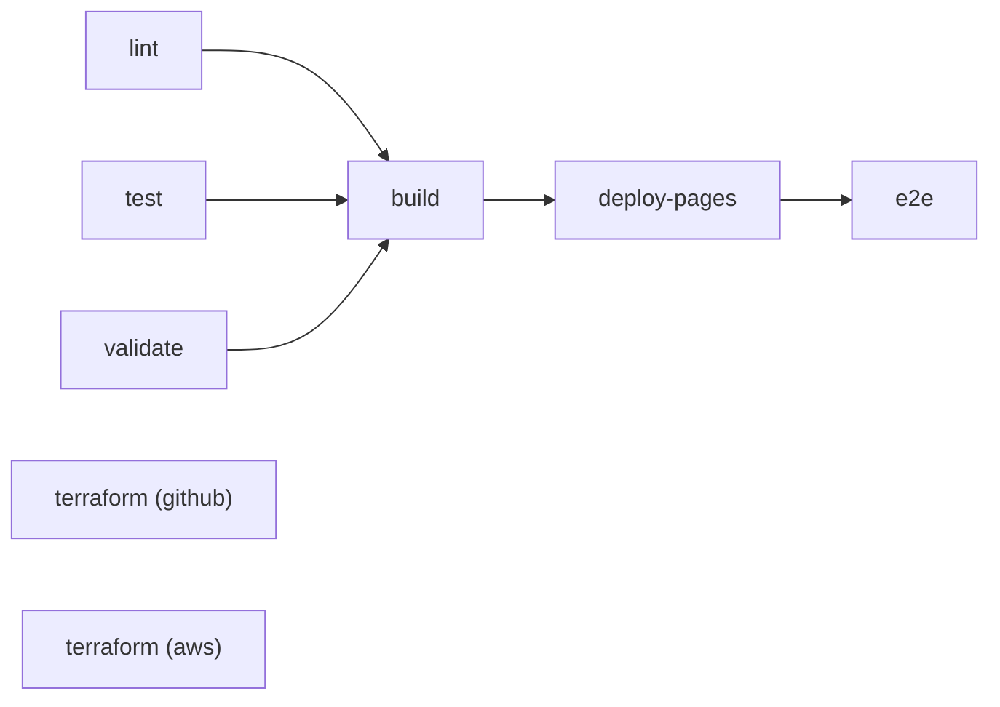

# assistente-qa

[](https://github.com/joaovictorrochaferreira/assistente-qa/actions/workflows/ci.yml)

Repositório da skill de QA **cenarios-de-teste** e do **qa-toolkit**, um conjunto de
ferramentas em Python que valida, verifica e empacota essa skill de forma automatizada.
Projeto da disciplina **DevOps na Prática (PUCRS)**, Fase 1: Configuração e Automação Inicial.

- Repositório: https://github.com/joaovictorrochaferreira/assistente-qa
- Pipeline de CI: https://github.com/joaovictorrochaferreira/assistente-qa/actions/workflows/ci.yml
- Relatório de testes publicado: https://joaovictorrochaferreira.github.io/assistente-qa/

---

## 1. Descrição do projeto

A skill `cenarios-de-teste` ([skill/cenarios-de-teste/SKILL.md](skill/cenarios-de-teste/SKILL.md))
orienta um assistente de IA a gerar cenários de teste em português, no estilo Gherkin
(DADO / QUANDO / ENTÃO), a partir de uma tarefa do ClickUp, de um diff de código e de
regras de negócio. Ela define um fluxo de 7 etapas e um formato de saída obrigatório.

Por ser um arquivo de texto com regras, a skill pode quebrar de formas silenciosas: uma
etapa removida por engano, um frontmatter inválido, um link interno quebrado ou cenários
de exemplo fora do formato. O projeto trata a skill como código e aplica a ela as práticas
de DevOps: versionamento, testes automatizados, integração contínua, empacotamento
reproduzível e infraestrutura como código.

O **qa-toolkit** (`src/qa_toolkit/`) tem quatro comandos:

| Comando | O que faz |
|---|---|
| `qa-toolkit validate-skill <pasta>` | Valida o frontmatter (`name` e `description`), a presença e a ordem das Etapas 1 a 7, as seções obrigatórias e os links internos do SKILL.md. |
| `qa-toolkit lint-features <arquivos ou pastas>` | Verifica arquivos `.feature` no formato da skill: bloco CONTEXTO (Background), IDs `CT001` únicos e em sequência, DADO / QUANDO / ENTÃO em maiúsculas e na ordem certa, sem passos vazios, sem indentação e sem linha em branco entre passos. |
| `qa-toolkit package <pasta>` | Valida a skill e gera `dist/cenarios-de-teste.zip`, pronto para instalar. O zip é reproduzível: o mesmo conteúdo gera sempre os mesmos bytes. |
| `qa-toolkit build-site` | Gera a página inicial do relatório de testes publicado no GitHub Pages. |

## 2. Objetivos

1. **Garantir a qualidade da skill a cada mudança**: nenhuma alteração entra na `main`
   sem passar por lint, testes, validação da skill e validação dos `.feature`.
2. **Automatizar o build**: gerar o pacote `.zip` da skill e o pacote Python a cada
   execução do pipeline, disponíveis como artefatos para download.
3. **Dar visibilidade aos resultados**: publicar o relatório de testes e de cobertura no
   GitHub Pages e verificar com um teste E2E que a publicação está correta.
4. **Evitar vazamento de segredos**: varrer o histórico do repositório com o gitleaks
   no CI e antes de cada commit.
5. **Gerenciar a infraestrutura como código**: configurar a proteção da branch, as labels
   e os tópicos do repositório com Terraform, e descrever em código o armazenamento de
   relatórios na AWS.

## 3. Requisitos

### 3.1 Requisitos funcionais

| ID | Requisito |
|---|---|
| RF01 | Validar que o SKILL.md tem frontmatter YAML com `name` (minúsculas e hífens, até 64 caracteres, igual ao nome da pasta) e `description` (até 1024 caracteres). |
| RF02 | Validar que as Etapas 1 a 7 existem, sem repetição e em ordem, e que as seções "Fontes de informação", "Fluxo de trabalho" e "Formato de saída" existem. |
| RF03 | Validar que os links internos do SKILL.md apontam para arquivos e âncoras existentes dentro da pasta da skill. |
| RF04 | Verificar arquivos `.feature` nas regras do formato documental da skill e informar arquivo, linha e motivo de cada problema. |
| RF05 | Gerar o pacote `.zip` da skill somente se ela for válida. |
| RF06 | Publicar no GitHub Pages um relatório com total de testes, falhas e cobertura, com links para os relatórios completos. |
| RF07 | Retornar código de saída diferente de zero em qualquer falha, para interromper o pipeline. |

### 3.2 Requisitos não funcionais

| ID | Requisito |
|---|---|
| RNF01 | Python 3.12, com dependência de execução única (PyYAML). |
| RNF02 | Cobertura de testes de no mínimo 90% (o pipeline falha abaixo disso). |
| RNF03 | Código sem erros no Ruff (lint e formatação). |
| RNF04 | Nenhum segredo versionado: tokens só em variáveis de ambiente ou nos segredos do GitHub. |
| RNF05 | Infraestrutura gratuita: o que é aplicado de fato (GitHub) não tem custo; a parte AWS é só validada. |
| RNF06 | Build reproduzível: o mesmo commit gera o mesmo `.zip`. |
| RNF07 | Pipeline com tempo limite por job e execução em menos de 10 minutos no total. |

## 4. Estrutura do repositório

```
.github/workflows/ci.yml        Pipeline de CI (GitHub Actions)
skill/cenarios-de-teste/        A skill de QA (SKILL.md)
src/qa_toolkit/                 Pacote Python: validador, linter, empacotador, relatório
features/                       Arquivos .feature de exemplo, validados no CI
tests/unit/                     Testes unitários (pytest)
tests/e2e/                      Teste E2E do relatório publicado (pytest-playwright)
tests/fixtures/                 Skills e .feature válidos e inválidos usados nos testes
infra/terraform/github/         Stack aplicada: governança do repositório no GitHub
infra/terraform/aws/            Stack só validada: bucket S3 para relatórios
infra/terraform/modules/        Módulos reutilizáveis usados pelas stacks
.pre-commit-config.yaml         Verificações locais antes de cada commit
.gitleaks.toml                  Configuração da varredura de segredos
pyproject.toml                  Pacote, dependências e configuração de pytest, cobertura e Ruff
```

## 5. Plano de integração contínua

### 5.1 Ferramentas

| Finalidade | Ferramenta |
|---|---|
| Repositório e versionamento | Git e GitHub |
| Orquestração do pipeline | GitHub Actions (`.github/workflows/ci.yml`) |
| Lint e formatação | Ruff |
| Testes unitários e cobertura | pytest, pytest-cov, pytest-html |
| Teste E2E | pytest-playwright (Chromium) |
| Varredura de segredos | gitleaks (no CI e no pre-commit) |
| Build | `qa-toolkit package` (zip da skill) e `python -m build` (wheel e sdist) |
| Publicação do relatório | GitHub Pages (fonte: GitHub Actions) |
| Infraestrutura como código | Terraform (`fmt`, `validate` e `plan` no CI) |

### 5.2 Gatilhos

- **push na `main`**: pipeline completo, incluindo publicação no Pages e teste E2E.
- **pull request** para qualquer branch: lint, testes, validação, build e Terraform.
  O deploy e o E2E não rodam em PR, porque o Pages só publica a partir da `main`.
- **workflow_dispatch**: execução manual pela aba Actions.

Em PRs, um push novo cancela a execução anterior do mesmo PR. Na `main` nada é cancelado,
para não interromper um deploy em andamento.

### 5.3 Etapas (jobs)



| Job | O que verifica | Falha quando |
|---|---|---|
| `lint` | Ruff (regras e formatação) e gitleaks no histórico completo | Há erro de lint, código fora do padrão ou segredo no histórico |
| `test` | Testes unitários com cobertura, relatório HTML e JUnit | Algum teste falha ou a cobertura fica abaixo de 90% |
| `validate` | `validate-skill` na skill e `lint-features` na pasta `features/` | A skill ou algum `.feature` viola as regras |
| `build` | Gera o `.zip` da skill e o pacote Python, e publica os dois como artefatos | A skill é inválida ou o empacotamento falha |
| `deploy-pages` | Publica o relatório no GitHub Pages (só na `main`) | A publicação falha |
| `e2e` | Abre o relatório publicado com o Playwright e confere status, falhas, cobertura e links | O relatório não mostra a execução atual aprovada |
| `terraform (github)` | `fmt`, `init`, `validate` e `plan` da stack do GitHub | Formatação, sintaxe ou plano inválidos |
| `terraform (aws)` | `fmt`, `init` e `validate` da stack AWS | Formatação ou sintaxe inválidas |

Os jobs `lint`, `test`, `validate` e os dois `terraform` rodam em paralelo. O `build` só
roda se os três primeiros passarem. O E2E espera o Pages exibir o ID da execução atual,
para não validar uma versão antiga em cache.

### 5.4 Artefatos gerados

| Artefato | Conteúdo | Retenção |
|---|---|---|
| `cenarios-de-teste-skill` | `cenarios-de-teste.zip`, pronto para instalar | padrão do GitHub (90 dias) |
| `qa-toolkit-python` | wheel e sdist do qa-toolkit | padrão do GitHub (90 dias) |
| `relatorio-testes` | relatório HTML, cobertura HTML, JUnit XML e coverage XML | 14 dias |
| `playwright-traces` | traces do Playwright, só quando o E2E falha | 7 dias |

### 5.5 Proteção da branch `main`

Configurada pelo Terraform (seção 6.2): a `main` só aceita merge com os checks `lint`,
`test`, `validate`, `build`, `terraform (github)` e `terraform (aws)` aprovados e com a
branch atualizada. Force push e exclusão da `main` ficam bloqueados.

### 5.6 Verificações locais (pre-commit)

```powershell
pip install -e ".[dev]"
pre-commit install
```

A partir daí, cada commit roda Ruff, gitleaks, `terraform fmt`, a validação da skill e o
lint dos `.feature` alterados, antes mesmo de o código chegar ao GitHub.

## 6. Especificação da infraestrutura

### 6.1 Visão geral

| Componente | Onde | Gerenciado por | Custo |
|---|---|---|---|
| Repositório Git | GitHub (público) | Manual (criação) e Terraform (governança) | Gratuito |
| Runners do CI | GitHub Actions, `ubuntu-latest` | `ci.yml` | Gratuito para repositório público |
| Hospedagem do relatório | GitHub Pages | `ci.yml` (deploy) | Gratuito |
| Governança do repositório | GitHub | Terraform, stack `github` (aplicada) | Gratuito |
| Arquivo de relatórios | AWS S3 | Terraform, stack `aws` (só validada) | Não aplicado |

Versões: Terraform 1.17, provider `integrations/github` 6.x e provider `hashicorp/aws` 6.x,
travadas nos arquivos `.terraform.lock.hcl`.

### 6.2 Stack `github` (aplicada)

Diretório `infra/terraform/github/`, que usa o módulo `modules/github-repo-governance/`.

| Recurso | Configuração |
|---|---|
| `github_branch_protection` | Branch `main`; checks obrigatórios do CI; branch atualizada antes do merge (`strict`); histórico linear; conversas resolvidas antes do merge; sem force push; sem exclusão. `enforce_admins = false`, para o dono do repositório pessoal poder corrigir a `main` em emergência. |
| `github_issue_label` (7) | `tipo: bug`, `tipo: melhoria`, `area: skill`, `area: ci`, `area: infra`, `area: testes`, `area: documentacao` |
| `github_repository_topics` | `devops`, `github-actions`, `terraform`, `qa`, `gherkin`, `test-automation`, `python`, `claude-skill` |

Variáveis: `github_owner` (obrigatória), `repository_name` (padrão `assistente-qa`) e
`required_status_checks` (padrão: os seis jobs obrigatórios do CI).

**Como aplicar (PowerShell):**

```powershell
# O token fica só na sessão do terminal, nunca em arquivo.
# Permissão necessária: Administration (leitura e escrita) no repositório.
$env:GITHUB_TOKEN = "<seu token>"

cd infra\terraform\github
terraform init
terraform plan  -var="github_owner=joaovictorrochaferreira"
terraform apply -var="github_owner=joaovictorrochaferreira"
```

Aplique depois que o CI tiver rodado pelo menos uma vez com sucesso. Antes disso, o GitHub
não conhece os nomes dos checks e a proteção bloquearia merges esperando checks que
nunca rodaram.

**Estado:** fica local (`terraform.tfstate`), fora do git pelo `.gitignore`. Por isso o
`plan` do CI é especulativo: sem acesso ao estado, ele mostra a configuração completa.
O resultado aparece no resumo da execução, na aba Actions.

### 6.3 Stack `aws` (só validada, nunca aplicada)

Diretório `infra/terraform/aws/`, que usa o módulo `modules/s3-reports-bucket/`. Descreve
como os relatórios seriam arquivados por mais tempo do que os artefatos do Actions.

| Recurso | Configuração |
|---|---|
| `aws_s3_bucket` | Nome `assistente-qa-relatorios-<ambiente>-<id da conta>` (ou informado), com tags padrão `Projeto`, `Ambiente` e `Gerenciado` |
| `aws_s3_bucket_public_access_block` | Todo acesso público bloqueado |
| `aws_s3_bucket_ownership_controls` | `BucketOwnerEnforced` (ACLs desativadas) |
| `aws_s3_bucket_versioning` | Versionamento ativado |
| `aws_s3_bucket_server_side_encryption_configuration` | Criptografia AES256 com bucket key |
| `aws_s3_bucket_lifecycle_configuration` | Relatórios em `relatorios/` expiram em 90 dias; versões antigas em 30 dias; uploads incompletos em 7 dias |
| `aws_s3_bucket_policy` | Nega qualquer acesso sem TLS (`aws:SecureTransport = false`) |

Variáveis: `aws_region` (padrão `us-east-1`), `environment` (`dev`, `hml` ou `prd`),
`bucket_name` e `report_retention_days`. O CI roda `fmt` e `validate`, que não precisam
de credenciais. Para aplicar, seria preciso uma conta AWS e credenciais no ambiente.

### 6.4 Segredos e permissões

- O token do GitHub do Terraform fica só na variável de ambiente `GITHUB_TOKEN` do terminal.
- No CI, o workflow usa o `GITHUB_TOKEN` automático do Actions, com permissão padrão
  `contents: read`. Só o job `deploy-pages` recebe `pages: write` e `id-token: write`.
- `*.tfstate`, `*.tfvars` e `.env` estão no `.gitignore`.
- O gitleaks varre o histórico completo no CI e os arquivos alterados a cada commit.

## 7. Como rodar localmente (Windows, PowerShell)

```powershell
py -3.12 -m venv .venv
.\.venv\Scripts\Activate.ps1
pip install -e ".[dev]"

ruff check .
ruff format --check .
pytest --cov                                        # testes unitários e cobertura
qa-toolkit validate-skill skill\cenarios-de-teste
qa-toolkit lint-features features
qa-toolkit package skill\cenarios-de-teste --output dist

# E2E contra o relatório publicado
python -m playwright install chromium
pytest tests\e2e --base-url https://joaovictorrochaferreira.github.io/assistente-qa/
```
